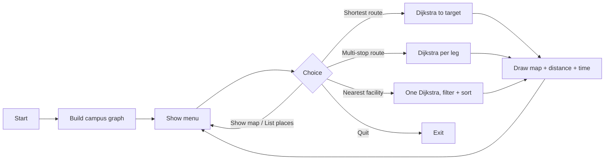
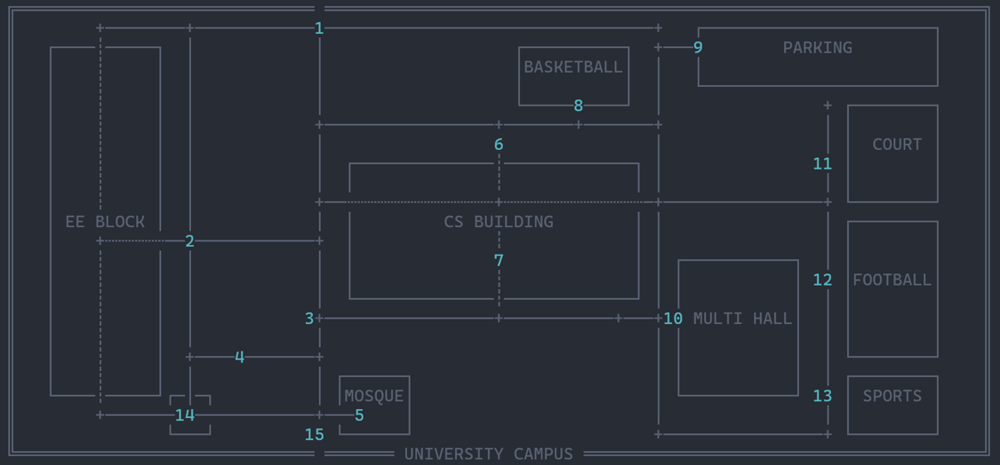

<div align="center">

# 🧭 CampusNav

**A campus route finder for the command line: shortest routes, multi-stop tours, and nearest-facility search, built in C++17 with every data structure written by hand.**

[](https://en.cppreference.com/)
[](https://en.wikipedia.org/wiki/Dijkstra%27s_algorithm)
[](#design-notes)
[](#getting-started)

[Features](#features) · [Getting Started](#getting-started) · [Report an Issue](../../issues)

</div>

---

## Overview

CampusNav is a console program that helps you find your way around a university campus. The campus is modelled as a **weighted, undirected graph**: 15 named places (Main Gate, EE Building, Fresh Juice Corner, Sports Room, ...) joined by walkways through a set of junctions, 47 nodes and 57 walkways in total.

Instead of storing pre-written directions, CampusNav computes the shortest path every time using **Dijkstra's algorithm with a min-heap**. Every result is drawn on a colored text map of the campus, along with the distance in meters and an estimated walking time.

It was built as a Data Structures lab project (FAST-NUCES, Fall 2026) to implement the core structures from scratch (hash table, linked list, stack, and heap) and see them work together on a real problem.

## Table of Contents

- [Features](#features)
- [Tech Stack](#tech-stack)
- [How It Works](#how-it-works)
- [Data Structures](#data-structures)
- [Getting Started](#getting-started)
- [Usage](#usage)
- [Project Structure](#project-structure)
- [Testing](#testing)
- [Design Notes](#design-notes)
- [Limitations](#limitations)
- [Roadmap](#roadmap)
- [Team](#team)

## Features

- **Shortest route** between any two of the 15 places, drawn on the map with total distance and walking time.
- **Multi-stop route** (A → B → C → ...) with up to 10 stops, showing per-leg distances and the overall total.
- **Nearest facility** search across 6 categories: food & drinks, prayer, sports, academic buildings, parking, and main gate / exit. All matches are ranked by distance from a single Dijkstra run.
- **Flexible input**: pick a place by its number or by any unique part of its name (e.g. `mosque`).
- **Input validation**: invalid, ambiguous, out-of-range, and duplicate inputs are rejected with a message and the prompt repeats, so the program never crashes on bad input.
- **Colored text map** with highlighted path, start / end / intermediate-stop markers, building outlines, and dashed corridors inside buildings.
- **Zero STL containers**: no `vector`, `map`, `priority_queue`, `stack`, or `queue`.

## Tech Stack

| Layer | Technology |
|---|---|
| Language | C++17 |
| Algorithm | Dijkstra's shortest path (binary min-heap) |
| Map rendering | ANSI colors, UTF-8 box-drawing characters, Bresenham's line algorithm |
| Libraries | `cstdio`, `iostream`, `cmath`, `cstring`, `std::string` (input only) |
| Compiler | GCC (`g++ -std=c++17 -O2`) |

## How It Works



- **Graph weights.** Node positions are pixel coordinates taken from the campus map image. Each edge weight is the Euclidean distance between its endpoints, converted to meters using the campus width (270 m measured on Google Maps over 1475 px, about 0.183 m per pixel).
- **Walking time.** Computed at 1.3 m/s.
- **Junctions and entrances.** Of the 47 nodes, 15 are selectable places. The rest are junctions along roads and walkways, including 7 hidden building entrances that connect the outdoor network to the corridors inside buildings.
- **Complexity.** Dijkstra with a binary heap runs in `O((V + E) log V)`, which is instant for V = 47, E = 57.

## Data Structures

All implemented from scratch:

| Structure | Used for |
|---|---|
| Hash table (separate chaining, djb2, 64 buckets) | Place name → node id lookup |
| Adjacency list (singly linked lists) | Graph representation |
| Min-heap (array-based) | Priority queue inside Dijkstra |
| Stack (growable array) | Reversing the parent chain into a start → destination path |
| Insertion sort | Ranking facilities by distance |
| Fixed arrays | Nodes, edges, distances, parents, and the map's character grid |

## Getting Started

### Prerequisites

- A C++17 compiler (GCC / `g++`)
- A terminal with **UTF-8 and ANSI color support**, at least **105 columns wide**

### Build and run

```bash
# 1. Clone the repository
git clone https://github.com/Usaim-Khan/CampusNav.git
cd CampusNav

# 2. Compile
g++ -std=c++17 -O2 main.cpp -o campus_map

# 3. Run
./campus_map          # Windows: campus_map.exe
```

On Windows the program enables UTF-8 output and ANSI colors automatically.

## Usage

```
=== CampusNav ===
1. Show map
2. Shortest route
3. Multi-stop route
4. Nearest facility
5. List locations
6. Quit
```

| Option | What it does |
|---|---|
| **1. Show map** | Draws the full campus map with numbered places and the location list |
| **2. Shortest route** | Asks for a start and destination, then draws the path with distance and walking time |
| **3. Multi-stop route** | Enter 2 to 10 stops in order (press Enter on an empty line to finish). Shows each leg plus the total |
| **4. Nearest facility** | Asks for your location and a category, then ranks all matches by distance and draws the nearest |
| **5. List locations** | Prints the 15 selectable places with their numbers |
| **6. Quit** | Exits the program |

Places can be entered by **number** (`1`–`15`) or by a **unique part of the name** (`mosque`, `juice`, `back gate`). Ambiguous names are rejected and you're asked again.

**Map legend:** green = start, red = end, magenta = intermediate stop, yellow = path.

### Campus map

<div align="center">
  
  <br>
  <sub>Menu option 1: the numbered places are what you pick from in the other options.</sub>
</div>

## Project Structure

```
CampusNav/
├── main.cpp      # Entire program: data structures, graph, Dijkstra, map drawing, menu
├── map.png       # Screenshot of the map (menu option 1)
├── .gitignore
└── README.md
```

The source is organised into clearly marked sections: hash table and stack, map data, graph, min-heap, Dijkstra and path building, and terminal drawing / menu / CLI.

## Testing

Tested manually against 6 cases on the final version, all passing:

- Shortest route, Main Gate → Sports Room (checked against a hand calculation from map coordinates)
- Multi-stop route whose total equals the sum of its legs (106 m + 213 m = 319 m)
- Nearest food & drinks from the Main Gate (Fresh Juice Corner, about 106 m)
- Selecting places by partial name (`mosque` → `sports`)
- Invalid input handling: letters, out-of-range numbers, bad menu choices
- Duplicate consecutive stops in a multi-stop route

Distances for the first two cases were verified manually from the map coordinates and matched the program's output. Every query returns instantly, and memory use is minimal since everything lives in small fixed-size arrays.

## Design Notes

A few deliberate choices worth calling out:

- **No STL containers.** The point of the project was to build the data structures, so the graph, heap, hash table, and stack are all hand-written. `std::string` is used only for reading user input.
- **One Dijkstra run per query where possible.** Nearest-facility search runs Dijkstra once from the user's location and filters by category, rather than running it once per candidate. Shortest route stops early as soon as the destination is finalized.
- **Stack for path reconstruction.** Dijkstra's parent chain gives the path from destination back to start; pushing it onto a stack and popping gives the correct order.
- **Map drawn from the same data as the graph.** The ASCII map is rendered from the node coordinates and edge list using Bresenham's line algorithm, so the picture and the routing can never disagree.
- **Hidden entrance nodes.** Building entrances are graph nodes that are not drawn, which lets routes pass through building corridors (drawn dashed) without cluttering the map.

## Limitations

- The map is hardcoded in the source; changing places or paths means editing the code and recompiling.
- Only two places are in the food category (Fresh Juice Corner and Biryani Stall), so "nearest food" has limited choices.
- Distances come from a pixel-to-meter conversion, so they are close estimates, not exact measurements.
- Console only; the map needs a UTF-8 / ANSI terminal at least 105 columns wide.
- No real-time information such as closed walkways or crowds.
- Fixed capacities: the heap holds 256 entries and a route can contain at most 500 nodes. These fit this map but would need raising for a larger one.

## Roadmap

- [ ] Load places, walkways, and categories from a file instead of hardcoding them
- [ ] Add more locations (cafes, food stalls) and more facility types
- [ ] Graphical or clickable web interface
- [ ] Blocked paths, plus ramp-only or women-only routes
- [ ] Compare A\* (straight-line heuristic) against Dijkstra

## Team

Built by three members of the Data Structures lab group:

| Member | Contributions |
|---|---|
| [Usaim Khan](https://github.com/Usaim-Khan) | Hash table, stack, map drawing, menu / CLI |
| Memoona | Map data, graph, distances, nearest facility |
| Amna Rehan | Min-heap, Dijkstra, multi-stop route, input checks |

---

<div align="center">

Built by [Usaim Khan](https://github.com/Usaim-Khan), Memoona, and Amna Rehan

</div>